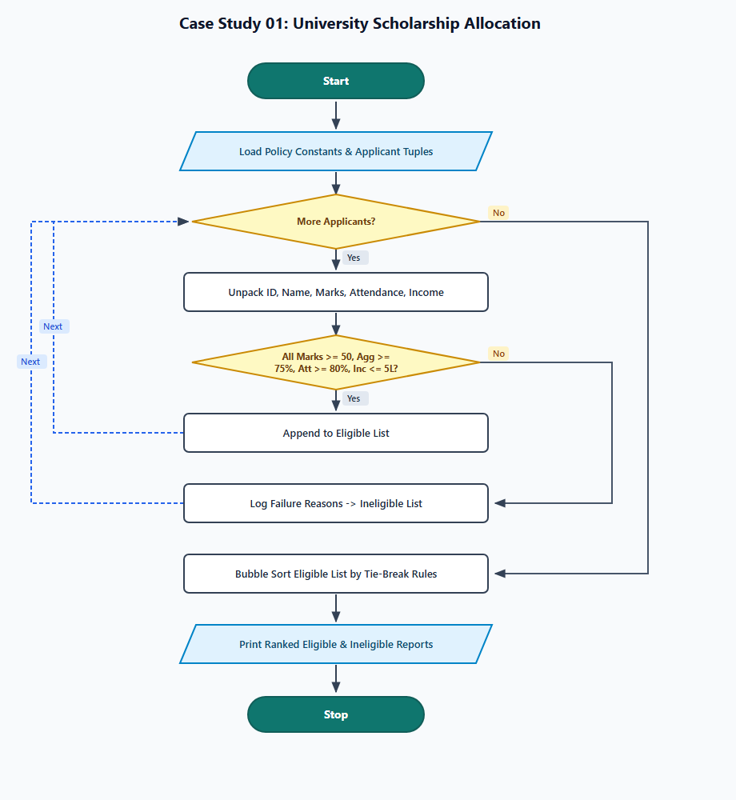
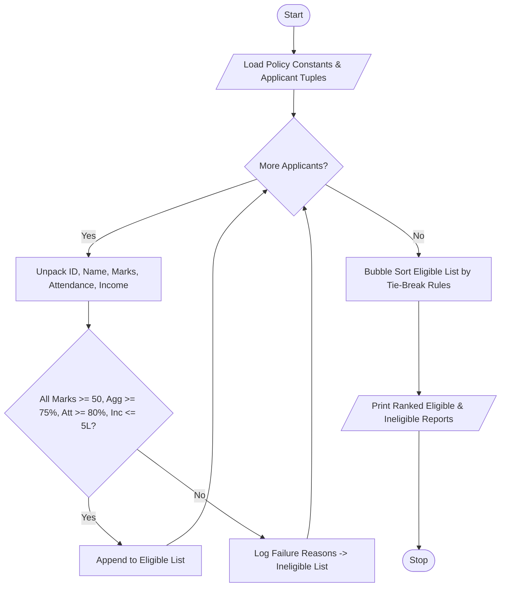
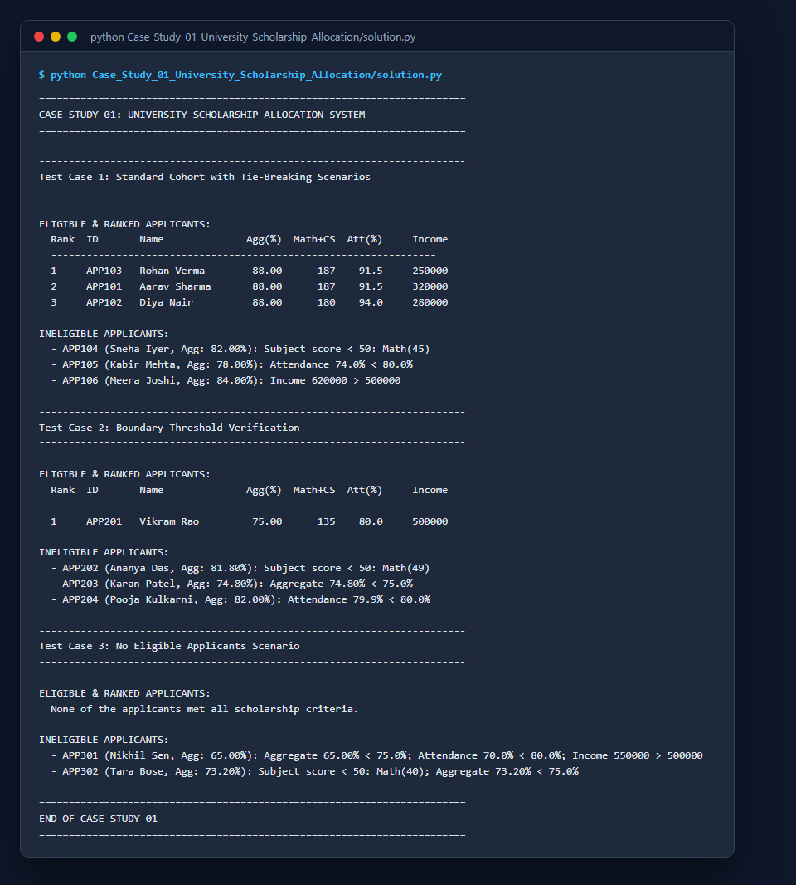

# Case Study 01: University Scholarship Allocation

## 1. Problem Statement
Design and implement a University Scholarship Allocation system that evaluates student applicants using aggregate marks, subject-wise minimum scores, attendance percentages, and annual family income criteria. Eligible applicants must be ranked deterministically using predefined tie-breaking rules, while ineligible applicants must be listed alongside every unmet eligibility condition.

---

## 2. Objectives
- Validate applicant academic marks across all five subjects (`Math`, `Physics`, `Chemistry`, `English`, `CS`).
- Enforce multi-criteria eligibility rules: minimum subject score, minimum aggregate percentage, minimum attendance, and maximum annual family income.
- Capture and report every failed condition for ineligible applicants.
- Rank eligible applicants deterministically using multi-level tie-breaking rules and tuple swapping.

---

## 3. Assumptions
- Each student has exactly 5 subjects, each graded on a `0–100` integer scale.
- Minimum subject-wise passing threshold is `50`.
- Minimum required aggregate percentage is `75.0%`.
- Minimum required attendance is `80.0%`.
- Maximum eligible annual family income is `500,000`.
- Tie-breaking priority order among eligible applicants:
  1. Higher aggregate percentage
  2. Higher combined `Math + CS` score
  3. Higher attendance percentage
  4. Lower annual family income
  5. Lexicographically smaller `app_id`

---

## 4. Algorithm
1. Start the program and define policy threshold constants and subject names tuple.
2. Iterate over each test case containing a cohort of applicant tuples `(app_id, name, marks, attendance, income)`.
3. Initialize empty `eligible_records` and `ineligible_records` lists.
4. For each applicant:
   - Unpack tuple fields.
   - Loop through `marks` to validate score bounds (`0–100`), accumulate `total_marks`, and collect any subjects with marks `< 50`.
   - Compute `aggregate_pct` and `math_cs_total`.
   - Check aggregate, attendance, and income against policy thresholds, appending any violations to `reasons`.
   - If `reasons` is empty, pack metrics into a tuple and append to `eligible_records`; otherwise append `(app_id, name, aggregate_pct, reasons)` to `ineligible_records`.
5. Sort `eligible_records` using nested-loop bubble sort comparing the 5 tie-breaking criteria and swapping via tuple unpacking.
6. Display the ranked eligible table and itemized ineligible report.
7. Stop.

---

## 5. Flowchart





---

## 6. Pseudocode
```text
BEGIN
    SET MIN_SUBJECT_MARK = 50, MIN_AGGREGATE_PCT = 75.0
    SET MIN_ATTENDANCE_PCT = 80.0, MAX_ANNUAL_INCOME = 500000

    FOR each (case_title, applicants) IN test_cases DO
        INITIALIZE eligible_records = [], ineligible_records = []

        FOR each applicant IN applicants DO
            UNPACK (app_id, name, marks, attendance, income) FROM applicant
            COMPUTE total_marks and failed_subjects
            SET aggregate_pct = total_marks / LENGTH(marks)
            SET math_cs_total = marks[0] + marks[4]
            COLLECT reasons IF any criterion fails

            IF LENGTH(reasons) == 0 THEN
                APPEND (aggregate_pct, math_cs_total, attendance, income, app_id, name) TO eligible_records
            ELSE
                APPEND (app_id, name, aggregate_pct, reasons) TO ineligible_records
            END IF
        END FOR

        SORT eligible_records BY aggregate DESC, math_cs_total DESC, attendance DESC, income ASC, app_id ASC
        PRINT ranked eligible_records and ineligible_records
    END FOR
END
```

---

## 7. Python Source Code
- Source File: [`solution.py`](./solution.py)
- Syllabus constructs used: Constants, `for` loops, nested loops, `if/elif/else`, strings, lists, nested lists, tuples, tuple unpacking, and tuple-swap sorting.

---

## 8. Test Cases

| Test Case | Scenario | Input Summary | Expected Outcome | Actual Outcome | Status |
|-----------|----------|---------------|------------------|----------------|--------|
| **TC1** | Standard cohort with ties | 6 applicants (`APP101`–`APP106`); `APP101` & `APP103` tie on aggregate & `Math+CS` (187) & attendance (91.5%) | `APP103` ranks #1 (lower income 250k < 320k), `APP101` #2, `APP102` #3; `APP104`–`APP106` rejected with exact reasons | Ranked `APP103`, `APP101`, `APP102`; `APP104` (Math 45), `APP105` (Att 74%), `APP106` (Income 620k) rejected | Pass |
| **TC2** | Boundary thresholds | `APP201` right on boundaries (50, 75%, 80%, 500k); `APP202`–`APP204` miss by 1 unit (`49`, `74.8%`, `79.9%`) | Only `APP201` eligible; `APP202`–`APP204` rejected | `APP201` ranked #1; `APP202`, `APP203`, `APP204` rejected | Pass |
| **TC3** | All ineligible cohort | 2 applicants (`APP301`, `APP302`) failing multiple criteria | 0 eligible; multi-reason rejection messages shown | Displayed "None eligible" and listed all unmet criteria for both | Pass |

---

## 9. Output Screenshots



---

## 10. Conclusion
The University Scholarship Allocation system successfully evaluates multi-dimensional applicant data using only core Python constructs (loops, conditionals, lists, tuples, and unpacking). Deterministic tie-breaking ensures fair, reproducible ranking even when multiple candidates share identical aggregate marks.
