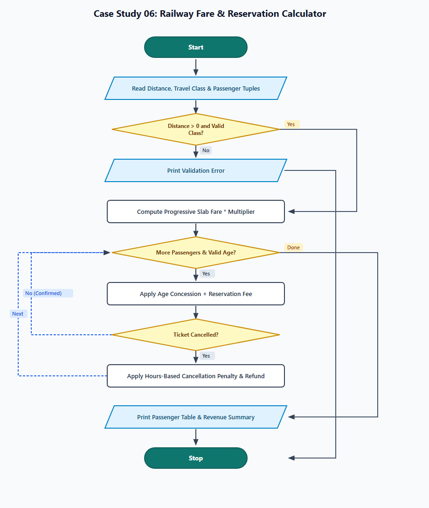
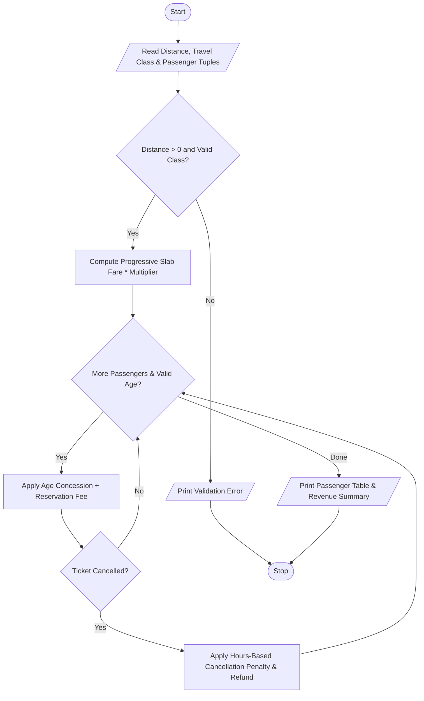
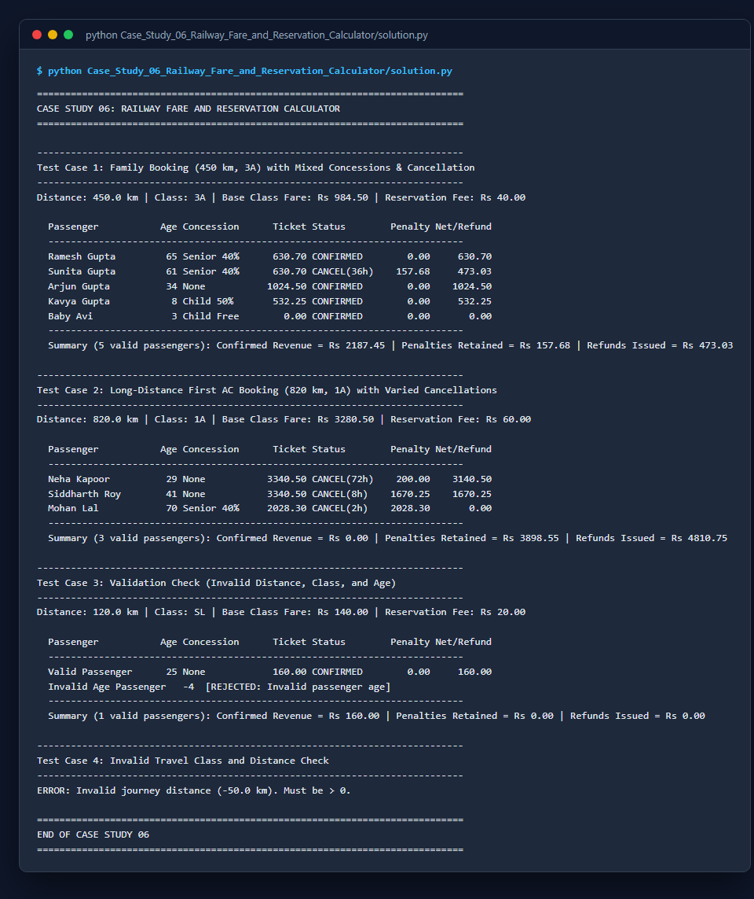

# Case Study 06: Railway Fare and Reservation Calculator

## 1. Problem Statement
Develop a Railway Fare and Reservation Calculator that computes ticket fares for multiple passengers across progressive distance slabs, travel classes (`SL`, `3A`, `2A`, `1A`), age-based concessions, and fixed class reservation fees, while also calculating cancellation penalties and refunds based on hours remaining before departure.

---

## 2. Objectives
- Validate journey distance, travel class codes, and individual passenger ages.
- Compute progressive distance-slab base fares and apply travel class multipliers and reservation fees.
- Apply age-based concessions (free travel below age 5, 50% child concession for 5–11, 40% senior citizen concession for 60+).
- Calculate cancellation penalties and refund amounts across four time tiers (`>= 48h`, `12–47h`, `4–11h`, `< 4h`).

---

## 3. Assumptions
- Progressive distance slabs (base adult rate before class multiplier):
  - `0–100 km`: Rs 1.20/km
  - `101–300 km`: Rs 1.00/km
  - `301–600 km`: Rs 0.85/km
  - `> 600 km`: Rs 0.70/km
- Class multipliers & reservation fees: `SL (1.0x, Rs 20)`, `3A (2.2x, Rs 40)`, `2A (3.0x, Rs 50)`, `1A (4.5x, Rs 60)`.
- Passengers under age 5 travel free with zero reservation fee; `cancel_hours = -1` indicates an active confirmed ticket.
- Flat minimum cancellation fee (`>= 48h`): `SL: Rs 60`, `3A: Rs 120`, `2A: Rs 150`, `1A: Rs 200`. Between `12–47h`, penalty is `max(25% of ticket, flat fee)`. Between `4–11h`, `50%`. Under `4h`, `100%` (no refund).

---

## 4. Algorithm
1. Start and define class catalog and flat cancellation fee tuples.
2. For each test case, unpack `(case_title, distance_km, travel_class, passengers)`.
3. Validate `distance_km > 0` and verify `travel_class` exists in `CLASS_CATALOG`.
4. Compute progressive slab fare by peeling off distance bands above 600, 300, 100, and 0 km, then multiply by the class multiplier.
5. Loop through each passenger tuple `(name, age, cancel_hours)`:
   - Reject invalid ages (`< 0` or `> 120`).
   - Determine concession rate and reservation fee based on age.
   - Compute `ticket_fare = base_class_fare * (1 - concession_rate) + p_res_fee`.
   - If `cancel_hours < 0`, mark `CONFIRMED` and add to `total_collected`.
   - Otherwise compute time-tier cancellation penalty (capped at `ticket_fare`) and `refund = ticket_fare - penalty`.
6. Print passenger breakdown and financial totals.
7. Stop.

---

## 5. Flowchart





---

## 6. Pseudocode
```text
BEGIN
    DEFINE CLASS_CATALOG and FLAT_CANCEL_FEES tuples

    FOR each (title, distance, travel_class, passengers) IN test_cases DO
        IF distance <= 0 OR travel_class NOT IN CLASS_CATALOG THEN
            PRINT validation error and CONTINUE
        END IF

        COMPUTE slab_fare progressively across 600+, 301-600, 101-300, 0-100 km bands
        SET base_class_fare = slab_fare * multiplier

        FOR each (name, age, cancel_hours) IN passengers DO
            IF age < 0 OR age > 120 THEN PRINT rejection and CONTINUE
            DETERMINE concession_rate and reservation_fee by age
            SET ticket_fare = base_class_fare * (1 - concession_rate) + reservation_fee
            IF cancel_hours < 0 THEN
                ADD ticket_fare TO total_collected
            ELSE
                COMPUTE penalty from cancel_hours tier and refund = ticket_fare - penalty
            END IF
        END FOR
        PRINT passenger breakdown and summary
    END FOR
END
```

---

## 7. Python Source Code
- Source File: [`solution.py`](./solution.py)
- Syllabus constructs used: Tuple catalogs, tuple unpacking, progressive conditional calculations, loops, `continue`/`break`, and formatted strings.

---

## 8. Test Cases

| Test Case | Scenario | Input Summary | Expected Outcome | Actual Outcome | Status |
|-----------|----------|---------------|------------------|----------------|--------|
| **TC1** | Family booking (450 km, 3A) | 5 passengers: 2 seniors (1 cancelled at 36h), 1 adult, 1 child (8y), 1 infant (3y) | Infant Rs 0, Child 50%, Seniors 40%; 36h cancel incurs max(25%, 120) = Rs 157.68 penalty | Confirmed Rs 2187.45, Penalty Rs 157.68, Refund Rs 473.03 | Pass |
| **TC2** | Long-distance 1A (820 km) | 3 cancelled tickets at `72h`, `8h`, and `2h` | Flat Rs 200 penalty at 72h, 50% at 8h, 100% at 2h | Penalties Rs 3898.55, Refunds Rs 4810.75 | Pass |
| **TC3** | Invalid passenger age | 120 km `SL` with valid age 25 and invalid age `-4` | Age `-4` rejected; valid passenger billed Rs 160.00 | Age `-4` flagged `[REJECTED]`; Revenue Rs 160.00 | Pass |
| **TC4** | Invalid distance & class | `-50.0` km, class `'XX'` | Error reported immediately before passenger processing | `ERROR: Invalid journey distance (-50.0 km)` | Pass |

---

## 9. Output Screenshots



---

## 10. Conclusion
The Railway Fare and Reservation Calculator accurately models multi-slab distance pricing, class multipliers, demographic concessions, and tiered cancellation rules using tuples, conditional branches, and iterative processing without any external libraries.
