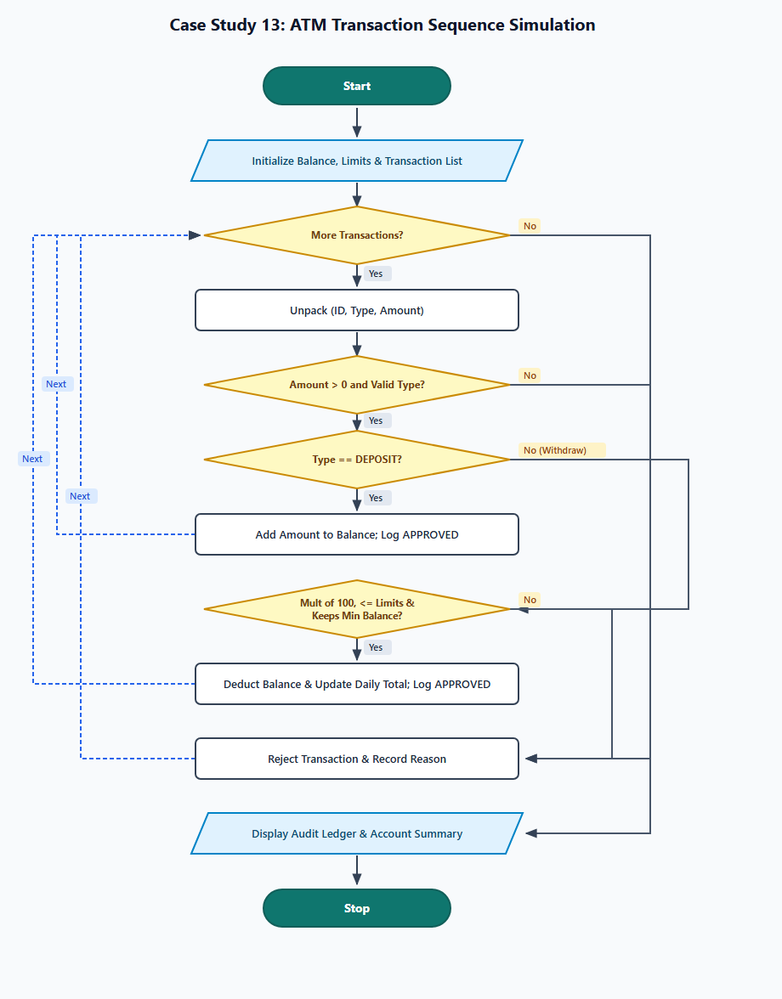
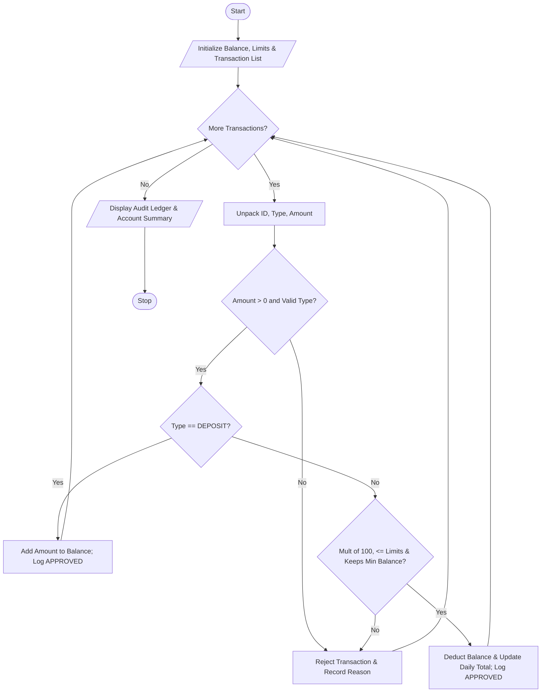
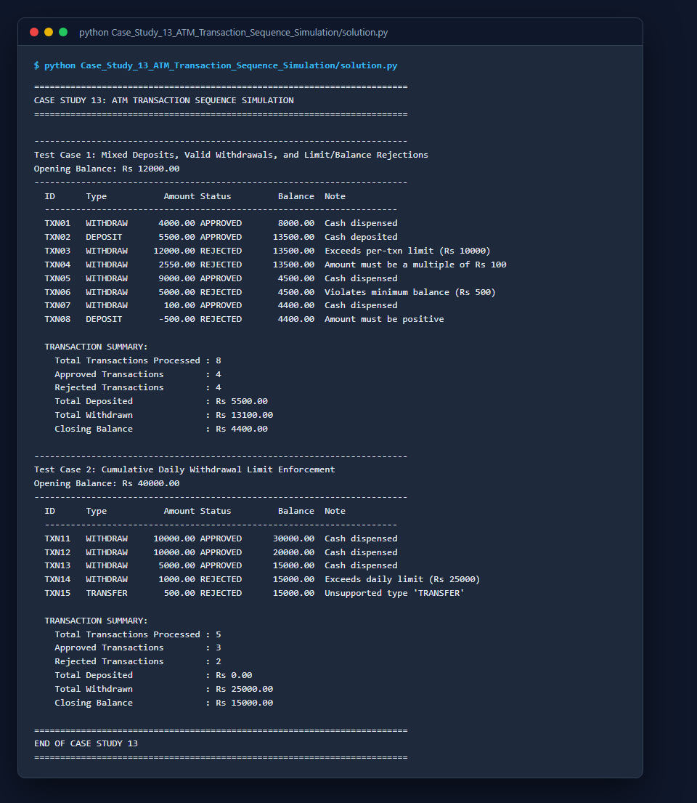

# Case Study 13: ATM Transaction Sequence Simulation

## 1. Problem Statement
Build an ATM Transaction Sequence Simulation that processes sequential deposits and withdrawals on a bank account, maintains a running simulated balance, enforces minimum balance, per-transaction limits, daily cumulative withdrawal limits, and denomination multiples, rejects invalid operations, and outputs a complete transaction summary.

---

## 2. Objectives
- Process sequential transaction tuples `(txn_id, txn_type, amount)` cleanly.
- Enforce business constraints: positive amounts, valid transaction types, Rs 100 multiples on withdrawals, Rs 10,000 per-transaction cap, Rs 25,000 daily withdrawal limit, and Rs 500 minimum balance.
- Maintain a detailed audit log recording status and rejection reasons without corrupting account balance.
- Produce a clear end-of-session financial summary.

---

## 3. Assumptions
- Minimum required account balance is `Rs 500.00`.
- Per-transaction withdrawal limit is `Rs 10,000.00`.
- Daily cumulative withdrawal limit is `Rs 25,000.00`.
- Withdrawals must be exact multiples of `Rs 100`.
- Only `"DEPOSIT"` and `"WITHDRAW"` transaction types (case-insensitive) are supported.

---

## 4. Algorithm
1. Start and set policy constants (`MIN_BALANCE`, `MAX_PER_WITHDRAWAL`, `MAX_DAILY_WITHDRAWAL`, `DENOMINATION_UNIT`).
2. For each scenario, initialize `balance`, `daily_withdrawn`, `total_deposited`, `approved_count`, `rejected_count`, and `audit_log`.
3. Loop through each transaction tuple `(txn_id, txn_type, amount)`:
   - Normalize `txn_type` with `.strip().upper()`.
   - If `amount <= 0`, reject with `"Amount must be positive"`.
   - Else if `DEPOSIT`, add to `balance` and `total_deposited`, mark `APPROVED`.
   - Else if `WITHDRAW`, validate `% 100 == 0`, `<= 10000`, `daily_withdrawn + amount <= 25000`, and `balance - amount >= 500`; if all pass, deduct from `balance` and add to `daily_withdrawn`.
   - Else reject unsupported transaction types.
   - Append `(txn_id, txn_type_clean, amount, status, balance, note)` to `audit_log`.
4. Print formatted audit ledger and session summary.
5. Stop.

---

## 5. Flowchart





---

## 6. Pseudocode
```text
BEGIN
    SET MIN_BALANCE = 500, MAX_PER_WITHDRAWAL = 10000, MAX_DAILY_WITHDRAWAL = 25000

    FOR each (title, initial_balance, transactions) IN test_cases DO
        SET balance = initial_balance, daily_withdrawn = 0, total_deposited = 0
        SET approved_count = 0, rejected_count = 0

        FOR each (txn_id, txn_type, amount) IN transactions DO
            IF amount <= 0 THEN
                LOG REJECTED ("Amount must be positive")
            ELSE IF UPPER(txn_type) == "DEPOSIT" THEN
                balance = balance + amount
                total_deposited = total_deposited + amount
                LOG APPROVED
            ELSE IF UPPER(txn_type) == "WITHDRAW" THEN
                IF amount % 100 != 0 OR amount > MAX_PER_WITHDRAWAL OR
                   daily_withdrawn + amount > MAX_DAILY_WITHDRAWAL OR
                   balance - amount < MIN_BALANCE THEN
                    LOG REJECTED with specific rule reason
                ELSE
                    balance = balance - amount
                    daily_withdrawn = daily_withdrawn + amount
                    LOG APPROVED
                END IF
            ELSE
                LOG REJECTED ("Unsupported type")
            END IF
        END FOR
        PRINT audit_log and summary metrics
    END FOR
END
```

---

## 7. Python Source Code
- Source File: [`solution.py`](./solution.py)
- Syllabus constructs used: Constants, `for` loops, nested `if/elif/else` validation, string normalization, lists, tuples, and tuple unpacking.

---

## 8. Test Cases

| Test Case | Scenario | Input Summary | Expected Outcome | Actual Outcome | Status |
|-----------|----------|---------------|------------------|----------------|--------|
| **TC1** | Mixed deposits, withdrawals & rejections | Opening Rs 12,000; 8 txns covering valid ops, >10k cap, non-100 multiple (2550), min-balance breach (5000 leaving <500), and `-500` deposit | 4 approved, 4 rejected; Deposited Rs 5500, Withdrawn Rs 13100, Closing Rs 4400 | 4 approved, 4 rejected; Deposited Rs 5500.00, Withdrawn Rs 13100.00, Closing Rs 4400.00 | Pass |
| **TC2** | Daily limit & invalid type | Opening Rs 40,000; withdrawals 10k + 10k + 5k + 1k, plus `"TRANSFER"` | First 3 withdrawals approved (25k); 1k rejected for daily limit; `TRANSFER` rejected | 3 approved, 2 rejected; Withdrawn Rs 25000.00, Closing Rs 15000.00 | Pass |

---

## 9. Output Screenshots



---

## 10. Conclusion
The ATM Transaction Sequence Simulation reliably tracks account state across sequential operations and prevents invalid balance mutations by validating denomination, transaction caps, daily limits, and minimum balance rules before committing changes.
