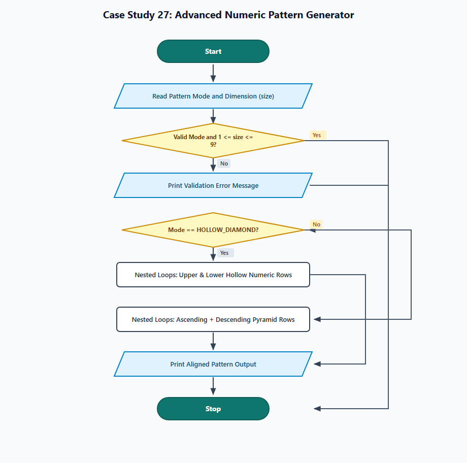
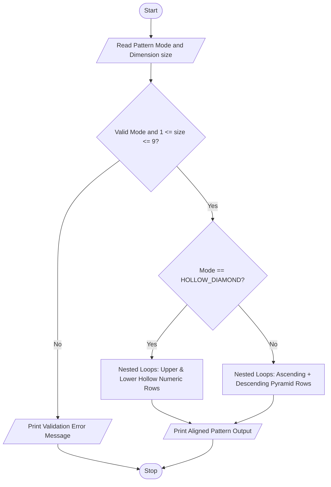
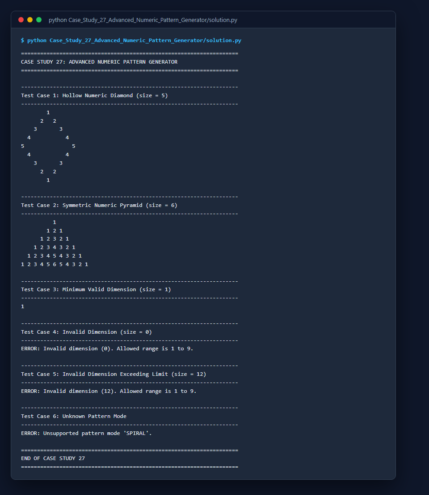

# Case Study 27: Advanced Numeric Pattern Generator

## 1. Problem Statement
Develop an Advanced Numeric Pattern Generator capable of producing aligned hollow numeric diamonds and symmetric palindrome numeric pyramids based on user-supplied dimensions, while validating invalid dimensions and unsupported pattern modes.

---

## 2. Objectives
- Generate symmetric hollow numeric diamond patterns using nested loops and spacing alignment.
- Generate symmetric ascending-descending numeric pyramids (`1 2 ... k ... 2 1`).
- Enforce dimension validation (`1 <= size <= 9`) so single-digit alignment remains intact.
- Reject unsupported pattern modes with clear error diagnostics.

---

## 3. Assumptions
- Supported pattern modes are `"HOLLOW_DIAMOND"` and `"SYMMETRIC_PYRAMID"` (case-insensitive).
- Valid dimension range is `1` to `9` inclusive to guarantee uniform single-digit column spacing.
- Trailing spaces on each generated line are stripped using `.rstrip()` for clean console output.

---

## 4. Algorithm
1. Start and set `MAX_DIM = 9`.
2. For each test case, unpack `(case_title, pattern_type, size)`.
3. Normalize `mode = pattern_type.strip().upper()`.
4. Validate `mode` is either `"HOLLOW_DIAMOND"` or `"SYMMETRIC_PYRAMID"`; otherwise print error and skip.
5. Validate `1 <= size <= MAX_DIM`; otherwise print dimension error and skip.
6. If `"HOLLOW_DIAMOND"`:
   - Loop `row` from `1` to `size` (upper half) and `size - 1` down to `1` (lower half).
   - Print leading indent `(size - row) * "  "`, then iterate `col` from `1` to `2 * row - 1`, printing `row` at `col == 1` or `col == width` and spaces otherwise.
7. If `"SYMMETRIC_PYRAMID"`:
   - Loop `row` from `1` to `size`.
   - Print leading indent `(size - row) * "  "`, ascending digits `1..row`, and descending digits `row-1..1`.
8. Stop.

---

## 5. Flowchart





---

## 6. Pseudocode
```text
BEGIN
    SET MAX_DIM = 9

    FOR each (title, pattern_type, size) IN test_cases DO
        SET mode = UPPER(STRIP(pattern_type))
        IF mode != "HOLLOW_DIAMOND" AND mode != "SYMMETRIC_PYRAMID" THEN
            PRINT "Unsupported pattern mode" and CONTINUE
        END IF
        IF size < 1 OR size > MAX_DIM THEN
            PRINT "Invalid dimension" and CONTINUE
        END IF

        IF mode == "HOLLOW_DIAMOND" THEN
            FOR row = 1 TO size DO print aligned hollow row END FOR
            FOR row = size - 1 DOWNTO 1 DO print aligned hollow row END FOR
        ELSE
            FOR row = 1 TO size DO
                print indent, ascending 1..row, descending (row-1)..1
            END FOR
        END IF
    END FOR
END
```

---

## 7. Python Source Code
- Source File: [`solution.py`](./solution.py)
- Syllabus constructs used: Nested `for` loops, `range()` step `-1`, conditional boundary checks, string concatenation and `.rstrip()`, tuples, and unpacking.

---

## 8. Test Cases

| Test Case | Scenario | Input Summary | Expected Outcome | Actual Outcome | Status |
|-----------|----------|---------------|------------------|----------------|--------|
| **TC1** | Hollow diamond (`size = 5`) | `"HOLLOW_DIAMOND"`, `5` | 9-row symmetric hollow diamond with digits `1..5..1` on edges | Aligned 9-row hollow numeric diamond printed | Pass |
| **TC2** | Symmetric pyramid (`size = 6`) | `"SYMMETRIC_PYRAMID"`, `6` | 6-row centered pyramid ending `1 2 3 4 5 6 5 4 3 2 1` | Aligned 6-row palindrome pyramid printed | Pass |
| **TC3** | Minimum boundary (`size = 1`) | `"HOLLOW_DIAMOND"`, `1` | Single-line `1` | Printed `1` | Pass |
| **TC4** | Zero dimension (`size = 0`) | `"HOLLOW_DIAMOND"`, `0` | Rejected with range error `1 to 9` | `ERROR: Invalid dimension (0). Allowed range is 1 to 9.` | Pass |
| **TC5** | Oversized dimension (`size = 12`) | `"SYMMETRIC_PYRAMID"`, `12` | Rejected with range error `1 to 9` | `ERROR: Invalid dimension (12). Allowed range is 1 to 9.` | Pass |
| **TC6** | Unknown mode (`"SPIRAL"`) | `"SPIRAL"`, `4` | Rejected as unsupported pattern mode | `ERROR: Unsupported pattern mode 'SPIRAL'.` | Pass |

---

## 9. Output Screenshots



---

## 10. Conclusion
The Advanced Numeric Pattern Generator demonstrates precise control over nested loops, index arithmetic, and whitespace alignment while safely handling invalid sizes and unsupported modes.
