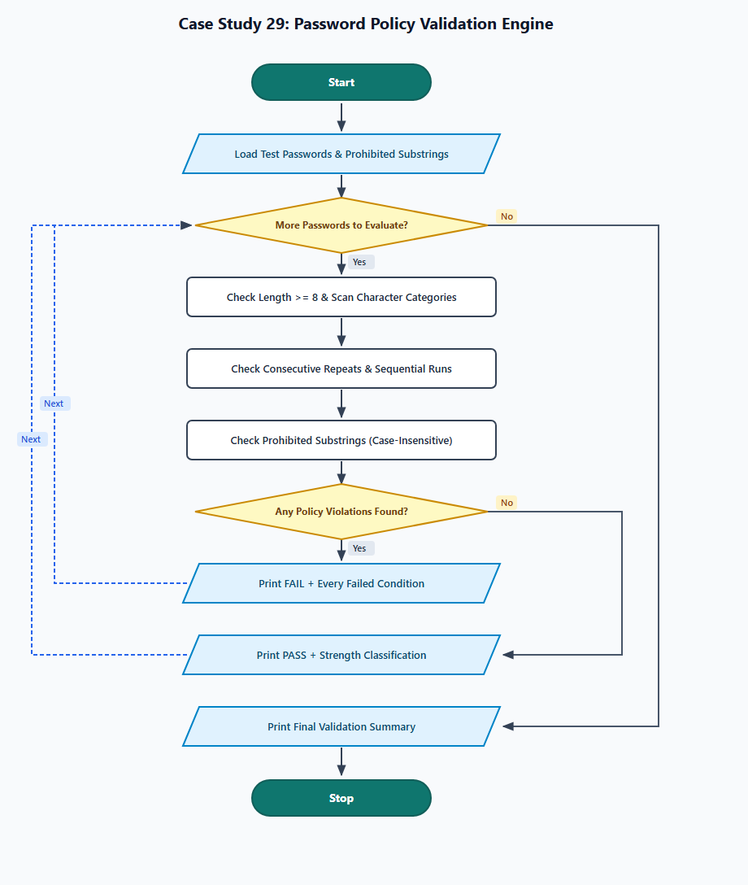
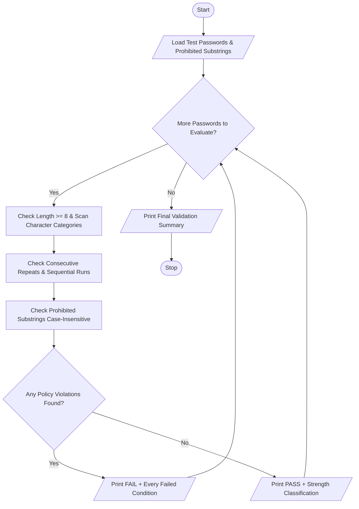
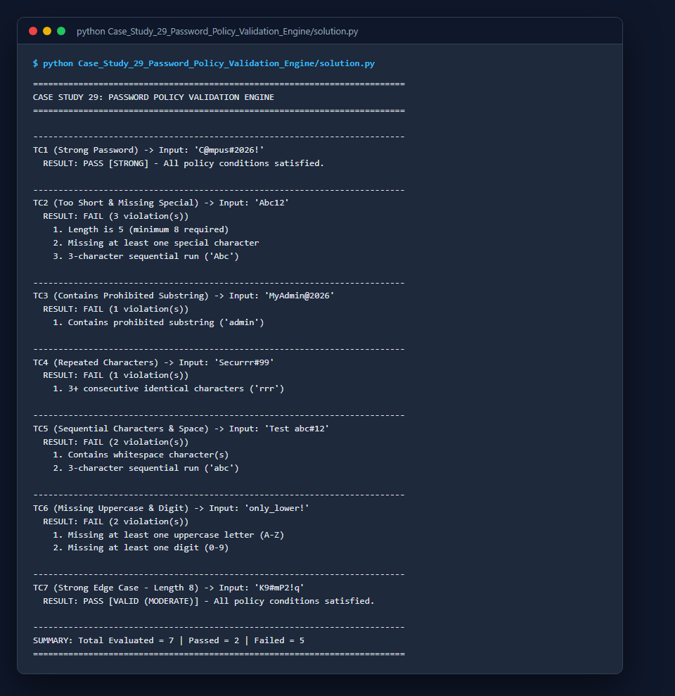

# Case Study 29: Password Policy Validation Engine

## 1. Problem Statement
Design a Password Policy Validation Engine that evaluates candidate password strings against minimum length, character-category diversity, consecutive character repetition, sequential run rules, and prohibited substring policies, reporting every failed condition clearly.

---

## 2. Objectives
- Enforce minimum password length (`>= 8`) and reject whitespace characters.
- Verify presence of uppercase letters, lowercase letters, digits, and special characters.
- Detect 3+ consecutive identical characters (e.g., `rrr`) and 3-character ascending alphanumeric sequences (e.g., `abc`, `123`).
- Flag prohibited dictionary substrings (case-insensitive) and classify passing passwords as `STRONG` (`>= 12` chars) or `VALID (MODERATE)`.

---

## 3. Assumptions
- Special characters belong to `"!@#$%^&*()-_=+[]{};:,.<>?"`.
- Prohibited substrings tuple: `("password", "admin", "qwerty", "1234", "welcome", "user")`.
- Spaces and tabs are strictly disallowed in passwords.
- Sequential run check uses ASCII code points (`ord()`) on alphanumeric triples.

---

## 4. Algorithm
1. Start and define `MIN_LENGTH = 8`, `SPECIAL_CHARS`, and `PROHIBITED_SUBSTRINGS`.
2. Initialize `valid_count = 0` and `invalid_count = 0`.
3. For each `(label, pwd)` in `test_passwords`:
   - Initialize an empty `failures` list.
   - Check `len(pwd) < MIN_LENGTH`.
   - Scan characters with a `for` loop setting boolean flags `has_upper`, `has_lower`, `has_digit`, `has_special`, `has_space`. Append failure messages for any missing category or detected space.
   - Scan triples `idx` to `len(pwd) - 3` for identical runs (`pwd[idx] == pwd[idx+1] == pwd[idx+2]`).
   - Scan lowercase alphanumeric triples for ascending ASCII runs (`c2 == c1 + 1` and `c3 == c2 + 1`).
   - Check if any item in `PROHIBITED_SUBSTRINGS` is present in `pwd.lower()`.
   - If `failures` is empty, increment `valid_count` and output `PASS` with strength label; otherwise increment `invalid_count` and list all failures.
4. Print final summary of total, passed, and failed counts.
5. Stop.

---

## 5. Flowchart





---

## 6. Pseudocode
```text
BEGIN
    SET MIN_LENGTH = 8
    SET PROHIBITED_SUBSTRINGS = ("password", "admin", "qwerty", "1234", "welcome", "user")

    FOR each (label, pwd) IN test_passwords DO
        SET failures = []
        IF LENGTH(pwd) < MIN_LENGTH THEN APPEND length error TO failures

        SCAN characters in pwd FOR upper, lower, digit, special, whitespace
        APPEND missing category or whitespace errors TO failures

        CHECK sliding 3-char windows FOR identical repeats and sequential ASCII runs
        CHECK pwd_lower FOR any prohibited substring

        IF LENGTH(failures) == 0 THEN
            PRINT PASS and strength ("STRONG" if len >= 12 else "VALID (MODERATE)")
        ELSE
            PRINT FAIL and every item in failures
        END IF
    END FOR
    PRINT overall summary
END
```

---

## 7. Python Source Code
- Source File: [`solution.py`](./solution.py)
- Syllabus constructs used: String traversal, `.isupper()`, `.islower()`, `.isdigit()`, `.isalnum()`, `.lower()`, `ord()`, slicing, membership checks (`in`), lists, tuples, and unpacking.

---

## 8. Test Cases

| Test Case | Input Password | Expected Outcome | Actual Outcome | Status |
|-----------|----------------|------------------|----------------|--------|
| **TC1** | `C@mpus#2026!` | `PASS [STRONG]` (length 12, all categories, no violations) | `PASS [STRONG]` | Pass |
| **TC2** | `Abc12` | `FAIL` (length < 8, missing special, sequential `'Abc'`) | `FAIL` (3 violations reported) | Pass |
| **TC3** | `MyAdmin@2026` | `FAIL` (prohibited substring `'admin'`) | `FAIL` (1 violation: `'admin'`) | Pass |
| **TC4** | `Securrr#99` | `FAIL` (3 identical consecutive chars `'rrr'`) | `FAIL` (1 violation: `'rrr'`) | Pass |
| **TC5** | `Test abc#12` | `FAIL` (whitespace + sequential `'abc'`) | `FAIL` (2 violations reported) | Pass |
| **TC6** | `only_lower!` | `FAIL` (missing uppercase & missing digit) | `FAIL` (2 violations reported) | Pass |
| **TC7** | `K9#mP2!q` | `PASS [VALID (MODERATE)]` (exact length 8 boundary) | `PASS [VALID (MODERATE)]` | Pass |

---

## 9. Output Screenshots



---

## 10. Conclusion
The Password Policy Validation Engine evaluates multiple security dimensions in a single pass and gives granular diagnostic feedback for every unmet policy rule using pure string manipulation, loops, and lists.
