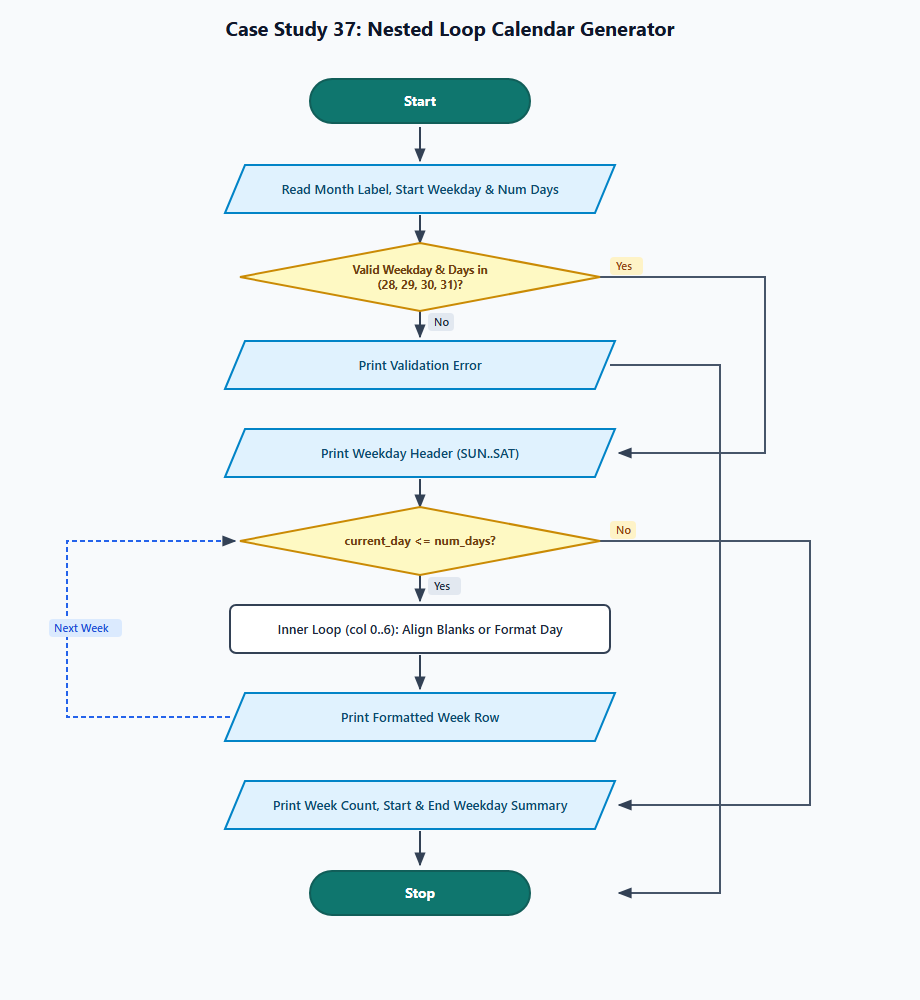
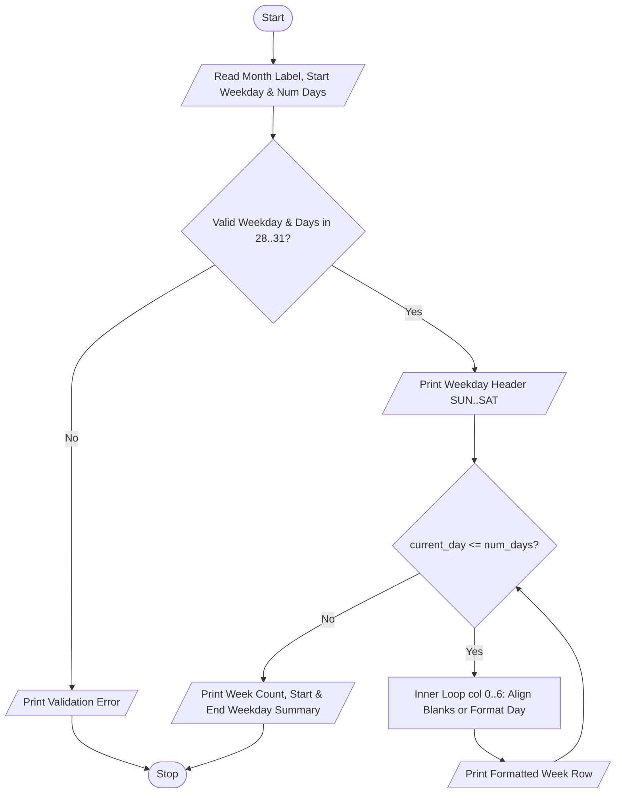
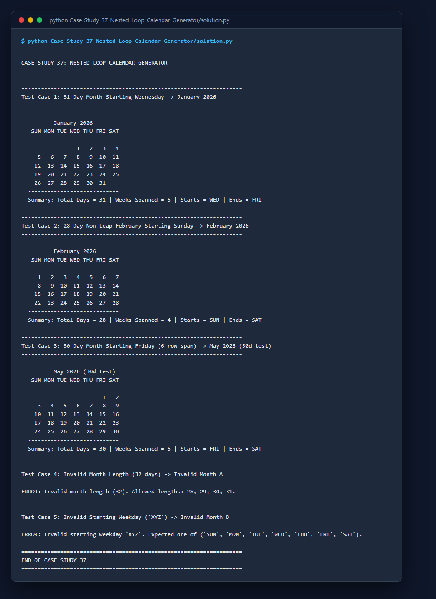

# Case Study 37: Nested Loop Calendar Generator

## 1. Problem Statement
Develop a Nested Loop Calendar Generator that produces a cleanly formatted monthly calendar grid given a month label, starting weekday (`SUN`–`SAT`), and month length (`28`–`31` days), accurately aligning weeks across rows and validating invalid inputs.

---

## 2. Objectives
- Validate starting weekday names against the 7-day tuple `("SUN", "MON", "TUE", "WED", "THU", "FRI", "SAT")`.
- Validate month lengths against `(28, 29, 30, 31)`.
- Use nested `while` and `for` loops to render aligned 7-column calendar weeks.
- Compute and report summary metadata: total days, weeks spanned, start weekday, and end weekday.

---

## 3. Assumptions
- Weekdays run from Sunday (`SUN`, index `0`) to Saturday (`SAT`, index `6`).
- Only standard Gregorian month lengths (`28`, `29`, `30`, `31`) are valid.
- Each day column is right-aligned to 4 characters for clean tabular alignment.

---

## 4. Algorithm
1. Start and define `WEEKDAYS` and `VALID_MONTH_LENGTHS` tuples.
2. For each test case, unpack `(case_title, month_label, start_code, num_days)`.
3. Normalize `start_code` and search for its index (`0..6`) in `WEEKDAYS`. If not found, print error and continue.
4. Check `num_days in VALID_MONTH_LENGTHS`. If false, print error and continue.
5. Print the month header and weekday column titles.
6. Set `current_day = 1` and `week_count = 0`.
7. Loop `while current_day <= num_days`:
   - Inner `for col in range(7)`:
     - If `week_count == 0` and `col < start_idx`, append 4 spaces.
     - Else if `current_day <= num_days`, append `f"{current_day:>4}"` and increment `current_day`.
   - Print the week row and increment `week_count`.
8. Compute `end_weekday_idx = (start_idx + num_days - 1) % 7` and print summary.
9. Stop.

---

## 5. Flowchart





---

## 6. Pseudocode
```text
BEGIN
    SET WEEKDAYS = ("SUN", "MON", "TUE", "WED", "THU", "FRI", "SAT")
    SET VALID_MONTH_LENGTHS = (28, 29, 30, 31)

    FOR each (title, label, start_code, num_days) IN test_cases DO
        FIND start_idx of UPPER(start_code) IN WEEKDAYS
        IF start_idx == -1 OR num_days NOT IN VALID_MONTH_LENGTHS THEN
            PRINT validation error and CONTINUE
        END IF

        PRINT label and WEEKDAYS header
        SET current_day = 1, week_count = 0
        WHILE current_day <= num_days DO
            SET row = ""
            FOR col = 0 TO 6 DO
                IF week_count == 0 AND col < start_idx THEN
                    APPEND "    " TO row
                ELSE IF current_day <= num_days THEN
                    APPEND formatted current_day TO row
                    INCREMENT current_day
                END IF
            END FOR
            PRINT row
            INCREMENT week_count
        END WHILE
        PRINT summary with end_weekday = WEEKDAYS[(start_idx + num_days - 1) % 7]
    END FOR
END
```

---

## 7. Python Source Code
- Source File: [`solution.py`](./solution.py)
- Syllabus constructs used: Nested `while` and `for` loops, modular arithmetic (`%`), tuples, membership check (`in`), string formatting, and tuple unpacking.

---

## 8. Test Cases

| Test Case | Scenario | Input Summary | Expected Outcome | Actual Outcome | Status |
|-----------|----------|---------------|------------------|----------------|--------|
| **TC1** | 31-day month starting Wednesday | `"January 2026"`, `"WED"`, `31` | 5 weeks; 1st under `WED`; ends on `FRI` | 5 weeks spanned; Starts `WED`, Ends `FRI` | Pass |
| **TC2** | 28-day Feb starting Sunday | `"February 2026"`, `"SUN"`, `28` | Exact 4-week grid; ends on `SAT` | 4 weeks spanned; Starts `SUN`, Ends `SAT` | Pass |
| **TC3** | 30-day month starting Friday | `"May 2026 (30d test)"`, `"FRI"`, `30` | 5 weeks; 1st–2nd in week 1; ends on `SAT` | 5 weeks spanned; Starts `FRI`, Ends `SAT` | Pass |
| **TC4** | Invalid month length (`32`) | `"Invalid Month A"`, `"MON"`, `32` | Rejected with allowed lengths error | `ERROR: Invalid month length (32).` | Pass |
| **TC5** | Invalid weekday (`"XYZ"`) | `"Invalid Month B"`, `"XYZ"`, `30` | Rejected with weekday validation error | `ERROR: Invalid starting weekday 'XYZ'.` | Pass |

---

## 9. Output Screenshots



---

## 10. Conclusion
The Nested Loop Calendar Generator demonstrates structured 2D grid alignment using nested loops, modular weekday wrap-around arithmetic, and strict input validation.
