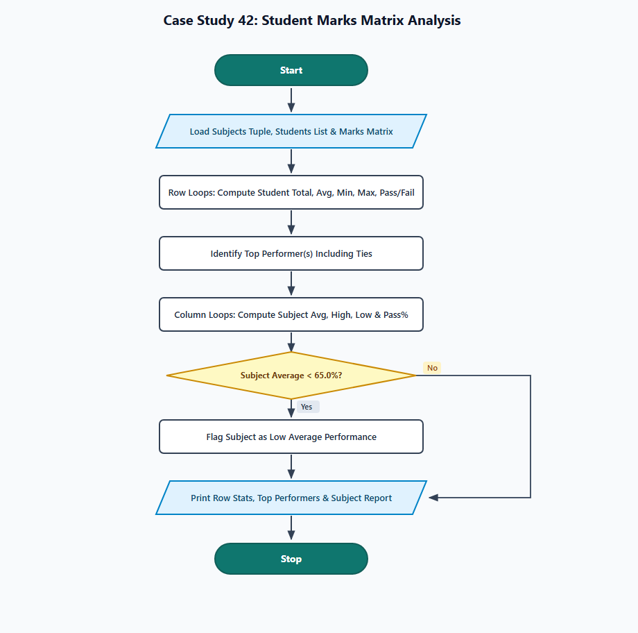
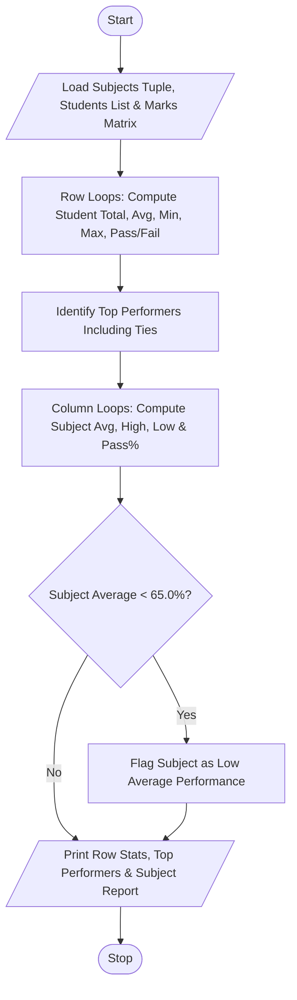
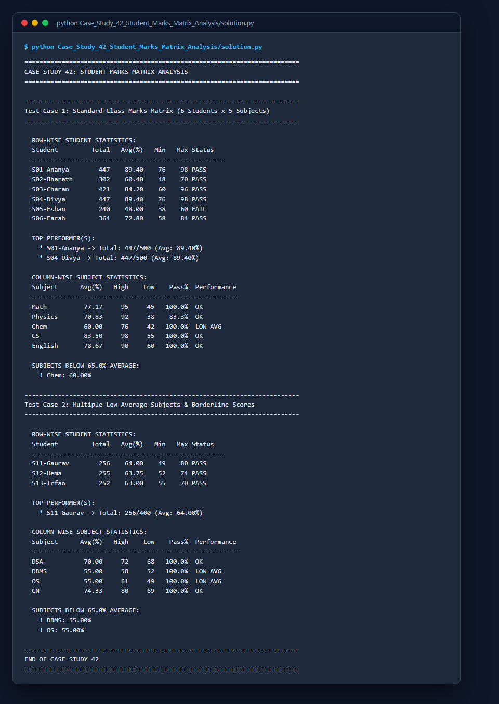

# Case Study 42: Student Marks Matrix Analysis

## 1. Problem Statement
Develop a Student Marks Matrix Analysis tool that processes a 2D nested list of student scores across multiple subjects, computes row-wise student statistics (total, average, min, max, pass/fail status), computes column-wise subject statistics (average, high, low, pass percentage), identifies top performers (including ties), and flags subjects with low average performance.

---

## 2. Objectives
- Store and traverse a 2D matrix of marks using nested lists and nested loops.
- Compute per-student row aggregations and determine overall `PASS`/`FAIL` status.
- Identify all tied top-performing students.
- Compute per-subject column aggregations and highlight subjects whose average falls below `65.0%`.

---

## 3. Assumptions
- Each row in `marks_matrix` corresponds to one student in `students_list`, and each column corresponds to one subject in `subjects_tuple`.
- Individual subject pass threshold is `40` marks out of `100`.
- A student passes overall only if they score `>= 40` in every subject.
- Subjects with a class average strictly below `65.0%` are flagged as `"LOW AVG"`.

---

## 4. Algorithm
1. Start and set `PASS_MARK = 40` and `LOW_AVG_THRESHOLD = 65.0`.
2. For each test case, unpack `(case_title, subjects, students, matrix)`.
3. Row-wise pass:
   - For each student row `r`, iterate over columns `c` to compute `row_total`, `row_min`, `row_max`, and `all_passed`.
   - Compute `row_avg = row_total / num_subjects`, track `highest_total`, and store summary tuples.
4. Scan `student_summaries` to collect all students whose total equals `highest_total` (preserving ties).
5. Column-wise pass:
   - For each subject column `c`, iterate over student rows `r` to compute `col_total`, `col_high`, `col_low`, and `pass_count`.
   - Compute `col_avg` and `pass_pct`; if `col_avg < 65.0`, append `(subjects[c], col_avg)` to `low_avg_subjects`.
6. Display student table, top performers, subject table, and low-average alerts.
7. Stop.

---

## 5. Flowchart





---

## 6. Pseudocode
```text
BEGIN
    SET PASS_MARK = 40, LOW_AVG_THRESHOLD = 65.0

    FOR each (title, subjects, students, matrix) IN test_cases DO
        SET highest_total = -1, student_summaries = []

        FOR r = 0 TO LENGTH(students) - 1 DO
            COMPUTE row_total, row_min, row_max, all_passed across matrix[r]
            UPDATE highest_total
            APPEND summary tuple TO student_summaries
        END FOR

        COLLECT all students in student_summaries WHERE total == highest_total

        FOR c = 0 TO LENGTH(subjects) - 1 DO
            COMPUTE col_total, col_high, col_low, pass_count across matrix[0..N-1][c]
            SET col_avg = col_total / LENGTH(students)
            IF col_avg < LOW_AVG_THRESHOLD THEN APPEND (subjects[c], col_avg) TO low_avg_subjects
        END FOR

        PRINT student_summaries, top_performers, subject stats, and low_avg_subjects
    END FOR
END
```

---

## 7. Python Source Code
- Source File: [`solution.py`](./solution.py)
- Syllabus constructs used: Nested lists (2D matrices), row-major & column-major nested loops, tuples, tuple unpacking, conditionals, and string formatting.

---

## 8. Test Cases

| Test Case | Scenario | Input Summary | Expected Outcome | Actual Outcome | Status |
|-----------|----------|---------------|------------------|----------------|--------|
| **TC1** | 6x5 matrix with tie & failure | 6 students x 5 subjects; `S01-Ananya` & `S04-Divya` both score 447; `S05-Eshan` has 38 in Physics; `Chem` avg 60.0% | `S01` & `S04` tied #1 (89.40%); `S05` marked `FAIL`; `Chem` flagged `LOW AVG` | Both top performers listed (447/500); `S05` FAIL; `Chem: 60.00%` flagged | Pass |
| **TC2** | 3x4 matrix with multiple weak subjects | 3 students x 4 CS subjects (`DSA`, `DBMS`, `OS`, `CN`); `DBMS` & `OS` avg 55.0% | `S11-Gaurav` top (256/400); `DBMS` and `OS` flagged below 65% | `S11-Gaurav` top (64.00%); `DBMS: 55.00%` & `OS: 55.00%` flagged | Pass |

---

## 9. Output Screenshots



---

## 10. Conclusion
The Student Marks Matrix Analysis program effectively traverses nested lists in both row-major and column-major order to produce comprehensive student and subject analytics with tie-aware ranking.
