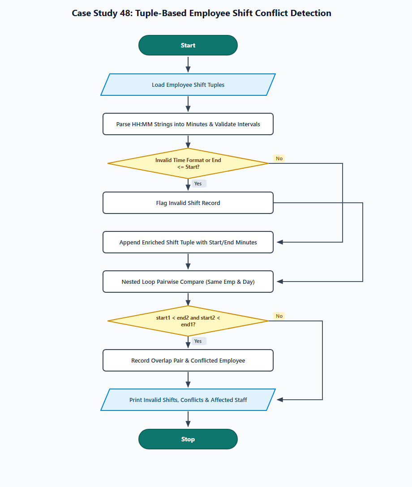
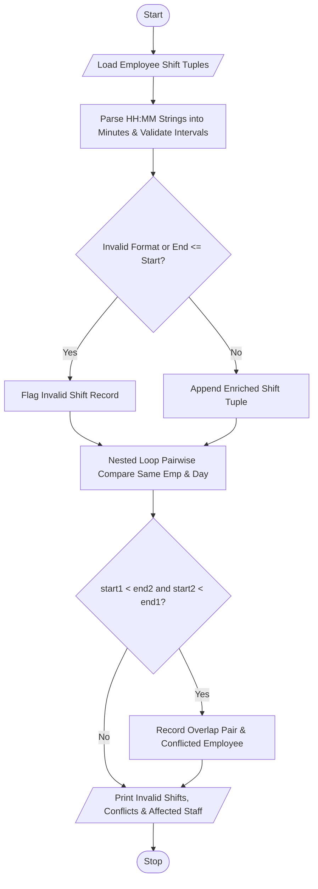
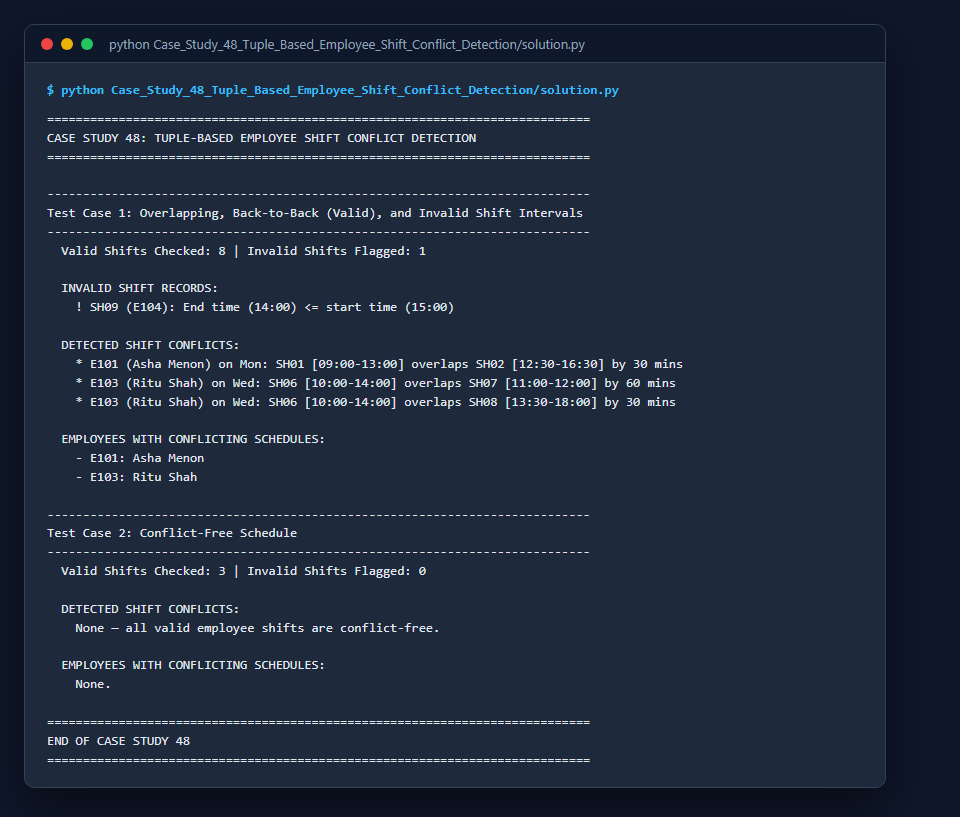

# Case Study 48: Tuple-Based Employee Shift Conflict Detection

## 1. Problem Statement
Build a Tuple-Based Employee Shift Conflict Detection system that stores employee work shifts as tuples `(shift_id, emp_id, emp_name, day, start_hhmm, end_hhmm)`, validates shift time formats and intervals, detects overlapping assignments for the same employee on the same day, and reports all conflicting shift pairs and affected employees.

---

## 2. Objectives
- Represent immutable shift records as tuples and enrich valid tuples using tuple concatenation (`+`).
- Parse `"HH:MM"` time strings using `.split(":")` and convert times to total minutes from midnight.
- Flag malformed time strings, out-of-range hours/minutes, and invalid intervals (`end <= start`).
- Use pairwise nested loops and strict interval overlap logic (`start1 < end2 and start2 < end1`) so back-to-back shifts (e.g., `08:00–12:00` and `12:00–16:00`) are allowed while true overlaps are caught.

---

## 3. Assumptions
- Times follow 24-hour `"HH:MM"` notation (`00:00` to `23:59`).
- A shift must have strictly positive duration (`end_total > start_total`).
- Shifts for the same employee that touch at an endpoint (e.g., ending at `12:00` and starting at `12:00`) are valid consecutive shifts, not conflicts.

---

## 4. Algorithm
1. Start and iterate over each test case's list of shift tuples.
2. Initialize `valid_shifts`, `invalid_shifts`, `conflicts`, and `conflicted_employees`.
3. For each `shift` tuple:
   - Unpack `(shift_id, emp_id, emp_name, day, start_str, end_str)`.
   - Split both time strings on `":"` and validate numeric components and 24-hour bounds.
   - Convert to `start_total` and `end_total` minutes; if `end_total <= start_total`, log in `invalid_shifts`.
   - Otherwise append `shift + (start_total, end_total)` to `valid_shifts`.
4. Run pairwise nested loops (`i` from `0` to `n-1`, `j` from `i+1` to `n-1`):
   - Unpack both tuples.
   - If `eid1 == eid2` and `day1 == day2` and `s1_min < e2_min and s2_min < e1_min`:
     - Calculate overlap duration in minutes and append conflict details to `conflicts`.
     - Add `(eid1, ename1)` to `conflicted_employees` if not already present.
5. Print invalid shift records, detected conflicts, and list of employees with conflicts.
6. Stop.

---

## 5. Flowchart





---

## 6. Pseudocode
```text
BEGIN
    FOR each (title, raw_shifts) IN test_cases DO
        INITIALIZE valid_shifts = [], invalid_shifts = [], conflicts = []

        FOR each shift IN raw_shifts DO
            UNPACK (shift_id, emp_id, emp_name, day, start_str, end_str)
            PARSE start_str and end_str into minutes_since_midnight
            IF invalid format OR out of range OR end_total <= start_total THEN
                APPEND (shift_id, emp_id, reason) TO invalid_shifts
            ELSE
                APPEND shift + (start_total, end_total) TO valid_shifts
            END IF
        END FOR

        FOR i = 0 TO LENGTH(valid_shifts) - 1 DO
            FOR j = i + 1 TO LENGTH(valid_shifts) - 1 DO
                IF same employee AND same day AND s1 < e2 AND s2 < e1 THEN
                    COMPUTE overlap_mins = MIN(e1, e2) - MAX(s1, s2)
                    APPEND conflict record TO conflicts
                END IF
            END FOR
        END FOR

        PRINT invalid_shifts, conflicts, conflicted_employees
    END FOR
END
```

---

## 7. Python Source Code
- Source File: [`solution.py`](./solution.py)
- Syllabus constructs used: Tuples, tuple concatenation (`+`), tuple unpacking, string `.split()` & `.isdigit()`, nested loops, and conditionals.

---

## 8. Test Cases

| Test Case | Scenario | Input Summary | Expected Outcome | Actual Outcome | Status |
|-----------|----------|---------------|------------------|----------------|--------|
| **TC1** | Mixed overlaps, back-to-back & invalid interval | 9 shifts: `E101` overlaps 30m (`09:00–13:00` vs `12:30–16:30`); `E102` back-to-back (`08:00–12:00`, `12:00–16:00`); `E103` contained & partial overlaps; `E104` `15:00–14:00` | `SH09` flagged invalid; `E102` conflict-free; 3 conflicts detected across `E101` and `E103` | 8 valid, 1 invalid (`SH09`); 3 conflicts detected; `E101` & `E103` listed | Pass |
| **TC2** | Conflict-free schedule | 3 non-overlapping shifts across `E201` and `E202` | 0 invalid, 0 conflicts | 0 invalid, 0 conflicts | Pass |

---

## 9. Output Screenshots



---

## 10. Conclusion
Using tuple packing, concatenation, unpacking, and strict interval inequality checks, the system reliably separates valid back-to-back shifts from true scheduling conflicts while catching malformed shift intervals.
