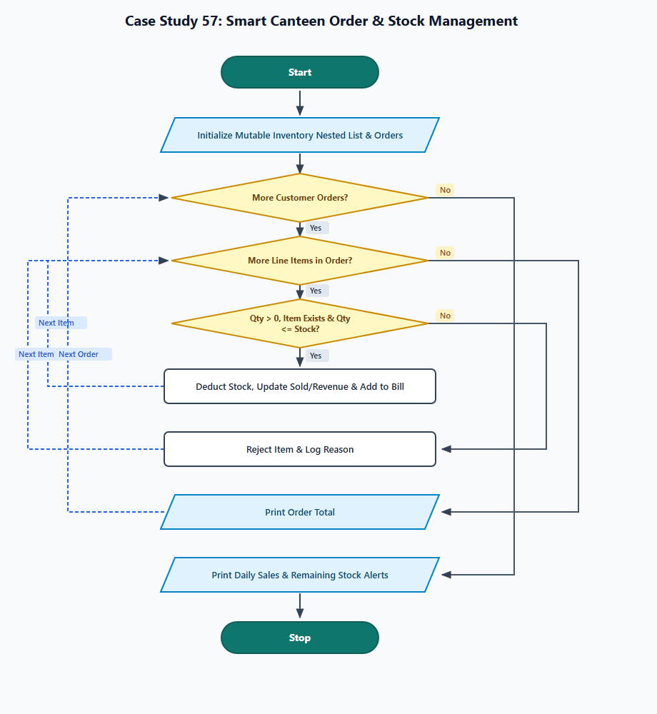
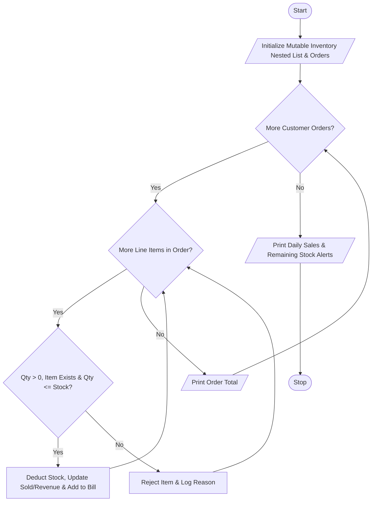
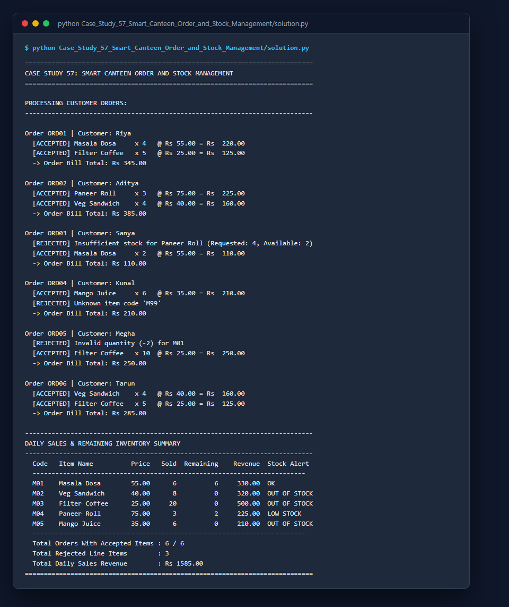

# Case Study 57: Smart Canteen Order and Stock Management

## 1. Problem Statement
Implement a Smart Canteen Order and Stock Management system that processes successive customer orders, calculates itemized and order-level bills, deducts sold quantities from live inventory, rejects unavailable quantities, invalid quantities, or unknown item codes, and generates a daily sales and stock alert summary.

---

## 2. Objectives
- Maintain a menu catalog as immutable tuples (`INITIAL_MENU`) and convert it into a mutable nested list (`inventory`) for live stock updates.
- Process multi-item customer orders sequentially so earlier orders deplete stock before later orders run.
- Reject line items with non-positive quantities, unknown item codes, or insufficient remaining stock while processing valid items in the same order.
- Report per-item sales, revenue, remaining stock, and stock alerts (`OUT OF STOCK`, `LOW STOCK`, `OK`).

---

## 3. Assumptions
- Each menu item record in `inventory` tracks `[code, name, unit_price, current_stock, units_sold, revenue]`.
- Low stock alert triggers when remaining quantity is `1 <= remaining <= 5`; `0` triggers `OUT OF STOCK`.
- Partial order fulfillment is supported: invalid or out-of-stock line items are rejected individually without blocking valid items in the same order.

---

## 4. Algorithm
1. Start and define `LOW_STOCK_THRESHOLD = 5`, `INITIAL_MENU`, and `customer_orders`.
2. Build mutable nested list `inventory` from `INITIAL_MENU` tuples, initializing `units_sold = 0` and `revenue = 0.0`.
3. Initialize `total_daily_revenue = 0.0`, `total_orders_fulfilled = 0`, and `rejected_line_items = []`.
4. For each `(order_id, customer, items)` in `customer_orders`:
   - Set `order_total = 0.0` and `accepted_lines = 0`.
   - For each `(item_code, qty)` in `items`:
     - Reject if `qty <= 0`.
     - Search `inventory` for matching `item_code`; reject if not found.
     - Reject if `qty > stock`.
     - Otherwise compute `line_cost = qty * price`, decrement stock, increment `units_sold` and `revenue`, add `line_cost` to `order_total`, and increment `accepted_lines`.
   - If `accepted_lines > 0`, increment `total_orders_fulfilled` and add `order_total` to `total_daily_revenue`.
   - Print order bill total.
5. Print daily sales table with stock alerts and aggregate totals.
6. Stop.

---

## 5. Flowchart





---

## 6. Pseudocode
```text
BEGIN
    SET LOW_STOCK_THRESHOLD = 5
    COPY INITIAL_MENU tuples into mutable inventory nested list

    FOR each (order_id, customer, items) IN customer_orders DO
        SET order_total = 0.0, accepted_lines = 0
        FOR each (item_code, qty) IN items DO
            IF qty <= 0 OR item_code not in inventory OR qty > stock THEN
                PRINT rejection reason and APPEND to rejected_line_items
            ELSE
                SET line_cost = qty * price
                UPDATE inventory stock, units_sold, revenue
                ADD line_cost TO order_total
                INCREMENT accepted_lines
            END IF
        END FOR
        IF accepted_lines > 0 THEN ADD order_total TO total_daily_revenue
        PRINT order_total
    END FOR

    PRINT daily sales table, stock alerts, and total revenue
END
```

---

## 7. Python Source Code
- Source File: [`solution.py`](./solution.py)
- Syllabus constructs used: Tuples, nested lists, in-place list element updates, sequential nested loops, conditionals, and tuple unpacking.

---

## 8. Test Cases

| Order / Check | Customer | Input Items | Expected Outcome | Actual Outcome | Status |
|---------------|----------|-------------|------------------|----------------|--------|
| **ORD01** | Riya | `M01 x 4`, `M03 x 5` | Both accepted; Bill Rs 345.00 | Accepted; Bill Rs 345.00 | Pass |
| **ORD02** | Aditya | `M04 x 3`, `M02 x 4` | Both accepted (`M04` drops to 2); Bill Rs 385.00 | Accepted; Bill Rs 385.00 | Pass |
| **ORD03** | Sanya | `M04 x 4`, `M01 x 2` | `M04` rejected (only 2 left); `M01` accepted; Bill Rs 110.00 | `M04` rejected; `M01` accepted; Bill Rs 110.00 | Pass |
| **ORD04** | Kunal | `M05 x 6`, `M99 x 1` | `M05` accepted (0 left); `M99` rejected (unknown); Bill Rs 210.00 | `M05` accepted; `M99` rejected; Bill Rs 210.00 | Pass |
| **ORD05** | Megha | `M01 x -2`, `M03 x 10` | `-2` rejected; `M03` accepted; Bill Rs 250.00 | `-2` rejected; `M03` accepted; Bill Rs 250.00 | Pass |
| **ORD06** | Tarun | `M02 x 4`, `M03 x 5` | Both accepted (`M02`, `M03` reach 0); Bill Rs 285.00 | Accepted; Daily Revenue Rs 1585.00; 3 `OUT OF STOCK`, 1 `LOW STOCK` | Pass |

---

## 9. Output Screenshots



---

## 10. Conclusion
The Smart Canteen Order and Stock Management solution accurately enforces real-time stock depletion across consecutive orders, gracefully rejects invalid or unavailable requests, and summarizes daily revenue and restocking alerts.
