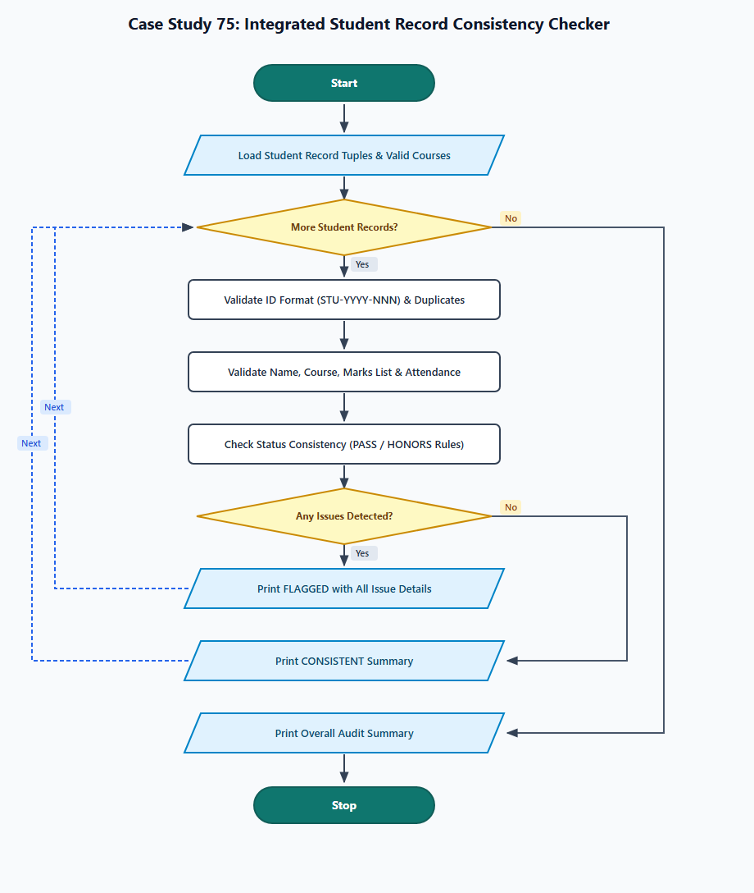
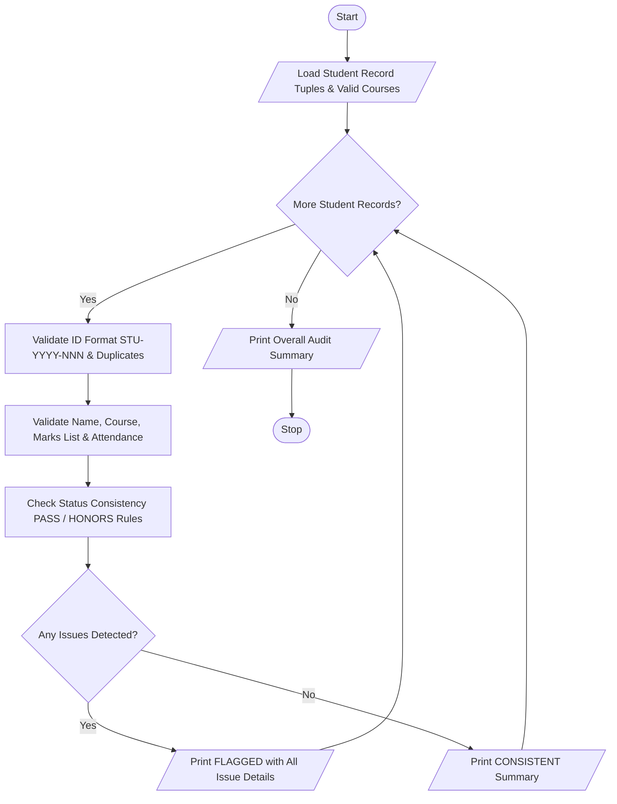
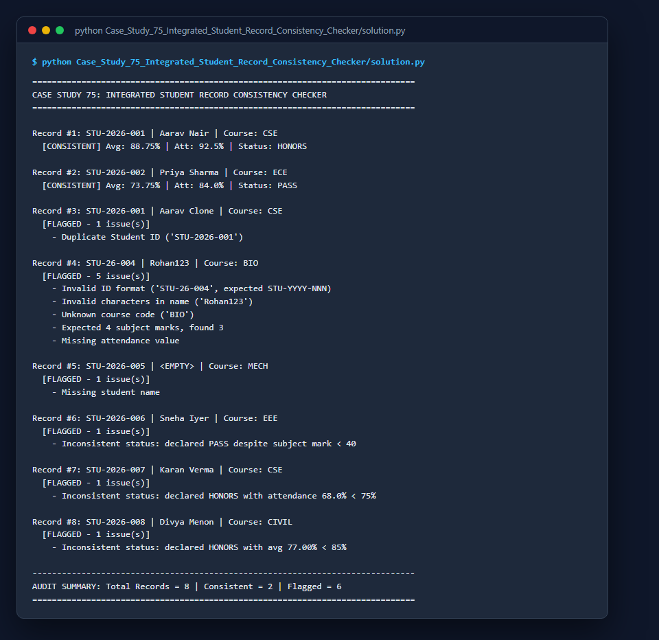

# Case Study 75: Integrated Student Record Consistency Checker

## 1. Problem Statement
Build an Integrated Student Record Consistency Checker that validates student identifiers, names, course codes, subject marks, attendance percentages, and declared academic statuses stored in lists and tuples, detecting duplicate IDs, missing values, format errors, and logical academic inconsistencies.

---

## 2. Objectives
- Validate student ID strings against the pattern `STU-YYYY-NNN` and detect duplicate student IDs across records.
- Verify student names (non-empty, alphabetic/space characters only) and validate course codes against `("CSE", "ECE", "EEE", "MECH", "CIVIL")`.
- Check marks lists for exact subject count (`4`), missing (`None`) values, and valid `0–100` bounds, and validate attendance (`0.0–100.0`, non-`None`).
- Cross-check declared status (`PASS` / `HONORS` / `FAIL`) against computed average, failed subjects (`< 40`), and minimum attendance (`75.0%`).

---

## 3. Assumptions
- Expected student ID format is `STU-YYYY-NNN` (total length 12, numeric 4-digit year and 3-digit sequence).
- Valid courses are `("CSE", "ECE", "EEE", "MECH", "CIVIL")`.
- Every student record must have `4` subject marks in the `0–100` range.
- `PASS` requires all subject marks `>= 40` and attendance `>= 75.0%`; `HONORS` additionally requires an average `>= 85.0%`.

---

## 4. Algorithm
1. Start and define validation constants (`VALID_COURSES`, `EXPECTED_SUBJECTS`, `PASS_MARK`, `MIN_ATTENDANCE`, `HONORS_AVG`).
2. Initialize `seen_ids = []`, `valid_count = 0`, `inconsistent_count = 0`.
3. For each record `(stu_id, name, course, marks, attendance, declared_status)`:
   - Initialize `issues = []`.
   - Validate `stu_id` length (`12`), prefix `"STU"`, and numeric year/sequence parts; check if `stu_id in seen_ids` (else append).
   - Validate non-empty `name` containing only letters or spaces.
   - Validate `course in VALID_COURSES`.
   - Validate `marks` length (`4`), no `None` entries, and `0 <= m <= 100`, tracking `total_marks` and `has_failed_subject`.
   - Validate `attendance` is not `None` and within `0.0–100.0`.
   - If marks and attendance are valid, check `declared_status` consistency against `PASS` and `HONORS` criteria.
   - Print `[CONSISTENT]` if `issues` is empty, otherwise `[FLAGGED]` with every detected issue.
4. Print overall audit summary.
5. Stop.

---

## 5. Flowchart





---

## 6. Pseudocode
```text
BEGIN
    SET VALID_COURSES = ("CSE", "ECE", "EEE", "MECH", "CIVIL")
    SET seen_ids = [], valid_count = 0, inconsistent_count = 0

    FOR each (stu_id, name, course, marks, attendance, status) IN student_records DO
        SET issues = []
        VALIDATE stu_id format and check duplicate in seen_ids
        VALIDATE name non-empty alpha/space and course IN VALID_COURSES
        VALIDATE marks length == 4, non-None, and 0 <= mark <= 100
        VALIDATE attendance non-None and 0.0 <= attendance <= 100.0
        IF marks_valid AND att_valid THEN
            CHECK declared status against failed subjects, attendance >= 75%, and avg >= 85% (for HONORS)
        END IF

        IF LENGTH(issues) == 0 THEN
            INCREMENT valid_count and PRINT CONSISTENT
        ELSE
            INCREMENT inconsistent_count and PRINT FLAGGED with issues
        END IF
    END FOR
    PRINT audit summary
END
```

---

## 7. Python Source Code
- Source File: [`solution.py`](./solution.py)
- Syllabus constructs used: String `.split()`, `.isdigit()`, `.isalpha()`, `.strip()`, `None` checks, lists, tuples, tuple unpacking, loops, and multi-condition validation.

---

## 8. Test Cases

| Record | Input Summary | Expected Outcome | Actual Outcome | Status |
|--------|---------------|------------------|----------------|--------|
| **#1** | `STU-2026-001`, `Aarav Nair`, `CSE`, `[88,91,84,92]`, `92.5%`, `HONORS` | Consistent (`88.75%` avg) | `[CONSISTENT] Avg: 88.75% \| Att: 92.5% \| Status: HONORS` | Pass |
| **#2** | `STU-2026-002`, `Priya Sharma`, `ECE`, `[72,68,75,80]`, `84.0%`, `PASS` | Consistent (`73.75%` avg) | `[CONSISTENT] Avg: 73.75% \| Att: 84.0% \| Status: PASS` | Pass |
| **#3** | `STU-2026-001`, `Aarav Clone` | Flagged: duplicate ID | `[FLAGGED - 1 issue(s)] Duplicate Student ID` | Pass |
| **#4** | `STU-26-004`, `Rohan123`, `BIO`, 3 marks, `None` att | Flagged with 5 distinct errors | `[FLAGGED - 5 issue(s)]` (ID, name, course, marks count, missing att) | Pass |
| **#5** | `STU-2026-005`, `""` name | Flagged: missing name | `[FLAGGED - 1 issue(s)] Missing student name` | Pass |
| **#6** | `STU-2026-006`, mark `35`, declared `PASS` | Flagged: failed subject vs `PASS` | `[FLAGGED - 1 issue(s)] declared PASS despite subject mark < 40` | Pass |
| **#7** | `STU-2026-007`, att `68.0%`, declared `HONORS` | Flagged: low attendance vs `HONORS` | `[FLAGGED - 1 issue(s)] declared HONORS with attendance 68.0% < 75%` | Pass |
| **#8** | `STU-2026-008`, avg `77.0%`, declared `HONORS` | Flagged: avg < 85% vs `HONORS` | `[FLAGGED - 1 issue(s)] declared HONORS with avg 77.00% < 85%` | Pass |

---

## 9. Output Screenshots



---

## 10. Conclusion
The Integrated Student Record Consistency Checker performs multi-layered data integrity auditing—covering format rules, duplicates, missing values, numeric bounds, and cross-field academic consistency—using only core Python data structures.
